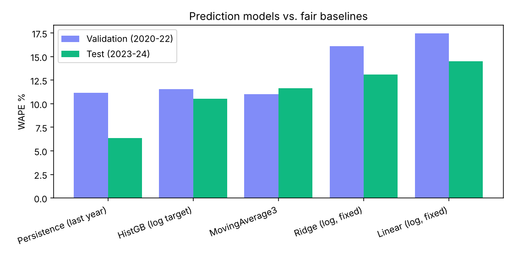
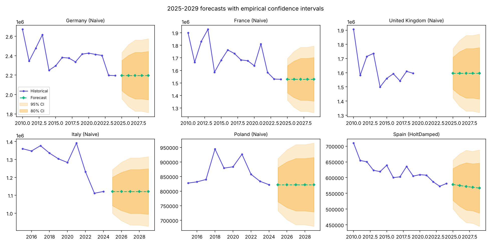

# ⚡ European Household Energy Intelligence System (2010–2024)


End-to-end data science project on Eurostat household energy consumption: data cleaning, EDA, feature engineering, prediction, forecasting, clustering, and a live Streamlit dashboard.

**Live app:** https://raoofhana231-web-raoofhana231-web-european-household-app-sj3ep4.streamlit.app/

## Key results (honest summary)

| Task | Best approach | Result |
|---|---|---|
| Prediction (country × year × end-use × fuel) | Persistence ≈ HistGB | Test WAPE: **6.4 %** persistence vs **10.6 %** HistGB |
| Forecasting 2025–2029 (country totals) | Naive (global winner), 6 countries use a better local model | Rolling-origin WAPE **5.3 %**, with 80/95 % empirical intervals |
| Clustering | KMeans, k = 2 | Silhouette **0.32** (best of k = 2…6) |

**What we learned**
- With strong autocorrelation, *last year's value* is a very hard baseline. ML models (HistGB, Ridge, Linear) did **not** beat it on the 2023–24 test set, so the dashboard reports the baseline next to every model.
- For country totals, simple methods (Naive, MovingAverage3) beat damped trend, Holt and linear trend in rolling-origin validation. Most forecasts are therefore flat — a validated result, not a bug. The intervals show the uncertainty.
- Clustering finds one robust split (25 mixed countries vs 6 electricity-heavy countries); more clusters create singleton groups and lower silhouette.




## Repository structure

```text
├── app.py                          # Streamlit dashboard (auto-discovers data/model files)
├── requirements.txt
├── scripts/
│   └── improve_pipeline.py         # baselines, bundle export, forecasts + CIs, k-selection
├── data/
│   ├── raw/                        # Eurostat source CSV
│   └── processed/                  # panel_level.csv, country_total.csv, ...
├── models/
│   ├── advanced_prediction_bundle.joblib
│   ├── best_prediction_model.joblib   # legacy fallback
│   ├── preprocessor.joblib
│   └── clustering_bundle.joblib
├── notebooks/                      # Phase 0–5, Feature_Engineering, Business_Analysis, ...
└── outputs/
    ├── figures/
    ├── evaluation_reports/
    └── advanced_forecasting/       # country_forecasts_2025_2029.csv (with CIs)
```

## Run locally

```bash
pip install -r requirements.txt
python scripts/improve_pipeline.py      # regenerates models, forecasts, reports, figures
streamlit run app.py
```

If the model fails to load after upgrading scikit-learn, re-run `scripts/improve_pipeline.py` to rebuild it with your installed version.

## Method notes
- **Split:** train ≤ 2019, validation 2020–2022, test ≥ 2023 (time-based, no shuffling).
- **Features:** lags 1–3, rolling mean/std (computed from past values only), year index.
- **Metric:** WAPE = Σ|y − ŷ| / Σ|y|.
- **Forecast validation:** rolling origins 2014–2023, horizons 1–5; a per-country model replaces the global winner only if ≥ 20 % better.
- **Intervals:** empirical relative-error spread per horizon, pooled across countries.
- **Limits:** 15 years of annual data per country; interval widths assume future errors resemble 2014–2024; 2025+ predictions in the Prediction page are recursive and drift in uncertainty.

Data: Eurostat (CC-BY).
